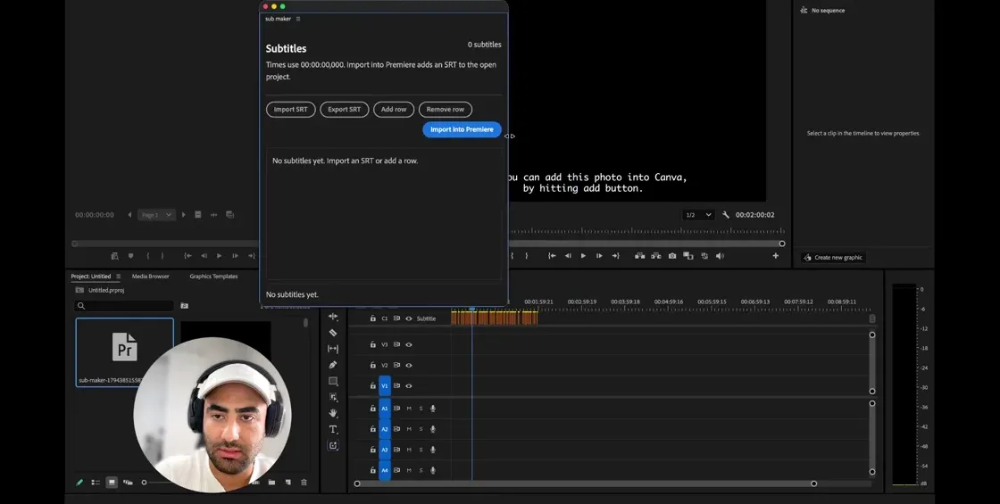

# UXP Assistant

**Build the plugin you wish existed.** Take a plugin idea from a sentence to an installable CCX, with checks guided by the Adobe app it will run in.

[](https://drive.google.com/file/d/1NL-8h8E_En4vBGMDkDBN3wAVzvJjHspw/view?usp=sharing)

[Watch the demo](https://drive.google.com/file/d/1NL-8h8E_En4vBGMDkDBN3wAVzvJjHspw/view?usp=sharing) · [Install](#install) · [How it works](#how-it-works)

## How it works

1. **Confirm the plan.** Choose the Adobe app, project folder, and permissions before scaffolding.
2. **Build for the host.** Use a searchable copy of Adobe’s documentation to guide the implementation.
3. **Check and package.** Run the build and available tests, check API use and permissions, and create a CCX.
4. **Try in the app.** Load the plugin in the target app and share screenshots or feedback for another revision.


## What you get

- **Host-specific guidance.** Work with documentation for Premiere Pro, Photoshop, InDesign, Media Encoder, Illustrator, or After Effects.
- **Catch issues earlier.** Checks cover the code and package. TypeScript checks run when the project supports them.
- **Maintain an existing plugin.** Use the same plan, check, and feedback loop to extend a project you already ship.

Load the plugin in the target Adobe app to verify its behavior. Build and package checks run locally.

## Install

You’ll need Node.js 20 or newer and GitHub access to the private repository.

```bash
git clone https://github.com/ThisIsMrAli/uxp-assistant.git
cd uxp-assistant
node install-agents.mjs --global
```

Open a new chat in **Codex**, **Claude Code**, or **Cursor** with your project open. The installer also links supported tools such as Gemini CLI and Windsurf. Keep the checkout on disk so the links continue to work. Omit `--global` to link skills inside the checkout only.

> Use uxp-assistant to create a Premiere Pro plugin that adds subtitles from text.


## Run

Node 20 or newer.

```bash
npm test
```

In an agent, say the sentence. The skill's own steps are in [`.claude/skills/uxp-assistant/SKILL.md`](.claude/skills/uxp-assistant/SKILL.md). To drive it by hand:

```bash
npm run skill -- start --goal "create a plugin that creates high quality QR codes in Premiere" --mode chat
npm run skill -- docs   --out <session folder>
npm run skill -- find   --out <session folder> canvas image
npm run skill -- build  --out <session folder>
npm run skill -- check  --out <session folder>
npm run skill -- feedback --out <session folder>      # the try card; answer it on the dashboard or in chat
```

`npm test` runs every `test/*.test.mjs` file with a fake Adobe site and a fake installer, so it needs no network. It also starts the dashboard server in-process and posts screenshots to it. It does not launch Photoshop or Premiere. A build and a CCX file do not either. When the host is not launched, the result is NOT TESTED.

## Dependency advisories

`npm ci` reports 7 moderate advisories, all through create-bolt-uxp 1.3.27, then meta-bolt, then archiver 7.0.1. The only upgrade `npm audit fix` offers is installer version 0.2.5, and npm marks that as a semver-major change. That downgrade removes the installer this skill pins, so it is not applied. There is no patched glob 10, minimatch 9, archiver 7.0, archiver-utils 5, or zip-stream 6 release. Jumping glob 10 to 14, or minimatch 9 to 11, is a different API and is not a safe override for the installer.

| Package | Advisory | Why it is not exploitable here |
| --- | --- | --- |
| glob 10.5.0 | [GHSA-3g3m-2fjr-6pw4](https://github.com/advisories/GHSA-3g3m-2fjr-6pw4), AbortSignal cancellation bypass | The skill calls `createBoltUXP` with a folder name, an id, and a display name. It does not pass an AbortSignal or a glob pattern. |
| minimatch 9.0.9 | [GHSA-g3hv-75wg-m249](https://github.com/advisories/GHSA-g3hv-75wg-m249), glob-parts denial of service | Nothing in this process feeds an attacker-controlled pattern to minimatch. The installer copies its own template. |
| archiver-utils, archiver, zip-stream, meta-bolt, create-bolt-uxp | Flagged because they depend on the two packages above | These run as a local scaffold in the folder the user named. This is not a service that archives or expands untrusted uploads. |

## Share a private preview

The owner enables GitHub Pages deliberately. `.github/workflows/pages.yml` runs only when someone starts it by hand. It does not deploy on a push to main, and it does not run on a schedule.

The source repository stays private. It does not appear on a public GitHub profile, and nobody can clone it without being given access.

GitHub Pages has no signature check. A private repository hides the source. It does not hide a Pages site. The preview address is an unguessable path, with an optional expiry, which is as close as Pages can come to a presigned URL:

- The site root says “Not found” and does not name the project.
- The page and its presentation assets exist only under that path.
- Anyone with the address can open it until you rotate the path, or until the date passes and the next deploy removes it.
- An expired path is removed the next time the owner runs the Pages workflow. `noindex` asks search engines not to list the site. That is not access control.

Do not put secrets on the page, and do not post the address in public. Publishing Pages from a private repository needs GitHub Pro, Team, or Enterprise. This project is not published from a public repository.

```bash
node scripts/share-link.mjs                 # print the address and store it in Actions secrets
node scripts/share-link.mjs --days 30       # the same, and remove the path 30 days later
node scripts/share-link.mjs --rotate        # invalidate the current address
node scripts/share-link.mjs --publish       # also start a deploy
```

The address is written to `.share/link.json` on this computer and to Actions secrets. `.share/` is not committed. The command refuses to continue when the repository is not private.

## License

[MIT](LICENSE)
